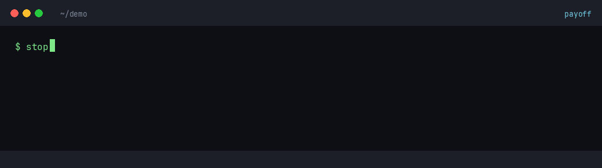

# cloud-browser

<h3 align="center">Hosted browser sessions — plus the sweep that stops the ones nobody closed.</h3>

<p align="center">
  <a href="LICENSE"></a>
  
  
  
</p>

<p align="center">
  
</p>

## What it is

`cloud-browser` covers **running a browser somewhere else**: stealth managed Chrome, managed
proxies, session recording, and a session that survives the local machine, through `agent-browser`
providers. Its second half is the part provider docs skip: a sweep that lists every browser your key can
see and stops them, so a crashed run does not keep billing.

## The problem it removes

A provider page tells you how to start a cloud browser. It does not tell you what happens when
the run dies before `close` — a real browser, still billing, with no handle to it. `stop_all.py` is that
handle.

## Install

```bash
# Claude Code — the whole collection as one marketplace
claude plugin marketplace add Appit-labs/appit-skills
claude plugin install cloud-browser@appit-skills

# pi
pi install git:github.com/Appit-labs/cloud-browser

# any agent that reads a skills directory
git clone git@github.com:Appit-labs/cloud-browser.git
cp -r cloud-browser/skills/cloud-browser ~/.claude/skills/      # or ~/.codex/skills/, .cursor/skills/, …
```

## Use

- **Start** — `agent-browser -p browseruse open <url>` (or your native browser tool)
- **Sweep** — `scripts/stop_all.py --dry-run` then `--yes [--keep ID]`
- **Record** — `BROWSER_USE_ENABLE_RECORDING=1` before launch

## What it does not do

- It does not pick a provider for you, and deliberately does not tabulate their limits — they change.
- It does not stop anything without `--yes`: `--yes` stops **every** browser the key can see.

## Requires

- `agent-browser` on PATH (`agent-browser doctor` shows provider state).
- The provider credential exported from the shell that launched your agent.
- Python 3.9+ for the sweep.

## Cost

| | tokens |
| --- | --- |
| always-on — the description, paid every session | ~94 |
| on invoke | ~1k |

The demo above is not a mockup: `demos/cloud-browser.json` holds the captured run and
`tools/make_demo.py` renders it, so it can be regenerated and audited.

## Security

SkillSpector: **0/100, SAFE, 0 open findings** against the committed baseline. Every accepted
finding is listed with its reason in [SECURITY.md](SECURITY.md). No `shell=True`, no credential
storage, no network destination chosen at runtime.

## Part of the Appit collection

[appit-skills](https://github.com/Appit-labs/appit-skills) — browser QA · CI triage · Postgres · runbooks ·
SSH · Trello · cloud browsers · OpenDesign · Blender.

## License

MIT, copyright Appit Labs. See [LICENSE](LICENSE).
